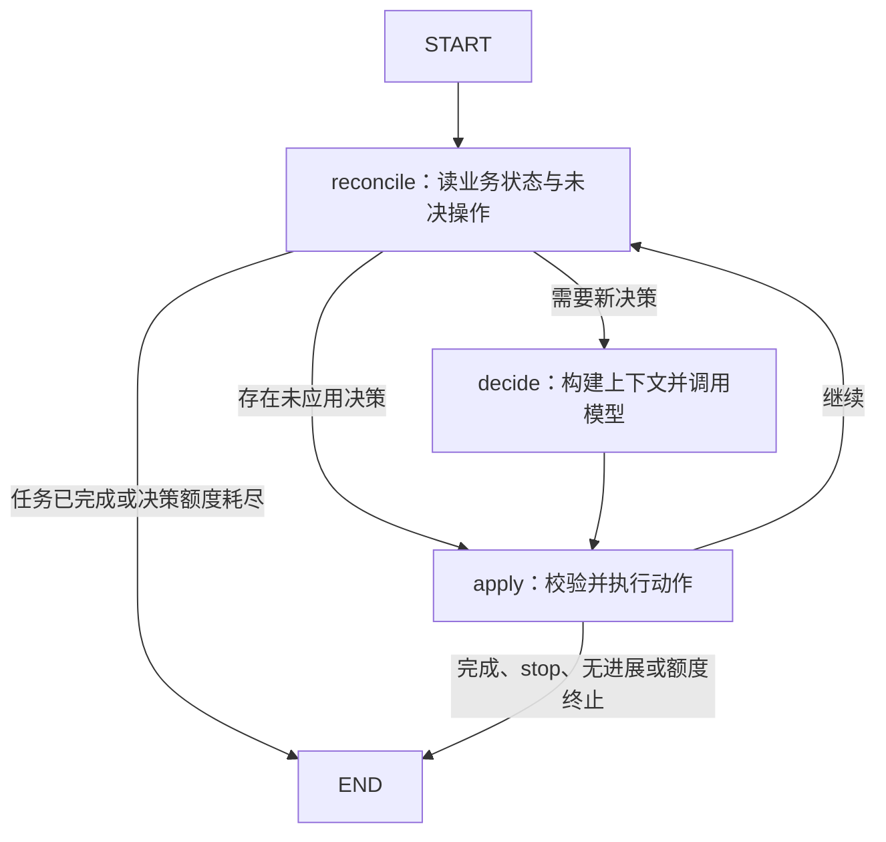

# 内容任务规划 Agent：LangGraph 实施设计 v2

更新：2026-11-06。状态：设计基线；实际实施范围与未完成项见 `04-implementation.md`，测试结果见 `03-evaluation.md`。

需求和业务计算以 `01-requirements.md` 为准；36 项审查结论见 `06-design-review.md`。根目录技术选型分析保留为演进记录。

## 1. 技术组合与框架边界

采用 Python、LangGraph Graph API、Pydantic、SQLite、tenacity、pytest 和 argparse CLI。持久化采用 `langgraph-checkpoint-sqlite` 的异步 saver 路线与 aiosqlite；运行目录互斥采用 portalocker。一个真实模型适配器和一个显式离线替身；首版不接第二个供应商。按所选供应商官方 SDK 接入，保持模型动作协议独立。

官方文档说明 checkpoint 保存 thread 内的图状态，异常后恢复与新输入、interrupt 恢复使用不同调用方式；节点重试会重执行节点函数，不能使外部副作用恰好发生一次。[S1][S2][S3] 业务账本因此由本项目管理，不依赖 saver 自动完成。

生产依赖版本在实际安装、最小恢复探针与测试通过后锁定，记录 Python、langgraph、langgraph-checkpoint-sqlite、Pydantic、tenacity 和模型 SDK 版本。当前不凭未安装环境填写“最新版本”。

## 2. 图结构和动作选择



当前实现只有 `reconcile`、`decide`、`apply` 三个 LangGraph 节点。早期设计中的 guard、context、validate_action、apply_plan、execute_tool 和 finalize 没有作为独立图节点落地，其职责分别合并到入口校验、`decide`、`apply`、Repository 和 run 收尾逻辑中。

- `reconcile`：从业务库读取任务终态和当前 run 的未应用决策；已完成直接结束，有未决动作则交给 `apply`，否则进入 `decide`。
- `decide`：从业务库重建有界上下文，预留运行额度，登记模型请求，调用模型并把原始响应保存为 decision。
- `apply`：校验 Action schema 与观察引用，执行计划动作或四个业务工具，记录结果，再做连续非法、重复失败、A→B→A 等无进展判断。

`apply` 的内部 dispatch 只按已经验证的模型 action 路由。工具结果、成本不可行、部分成功和永久失败在非终态时经 `reconcile` 返回下一轮 `decide`；方案超预算只阻止保存，不会由图自动切换格式。保存成功、模型 stop、无进展、非法动作上限或执行额度耗尽才结束。

工具业务记录与费用在 Repository 返回前完成事务提交；图中没有后置 `record_result` 节点。JSONL Trace 从数据库事件导出，导出失败不改变已保存方案事实。

## 3. 权威状态与 checkpoint

使用 `runtime/business.sqlite` 保存业务事实，`runtime/checkpoints.sqlite` 保存 LangGraph 进度，明确不承诺两个库的分布式原子事务。SQLite 对单一事务内的数据提供原子性，但这不能扩展成两个独立提交共同原子。[S4]

业务库是状态、费用、产物和决策的唯一权威。checkpoint 只保存投影和执行指针：

```text
GraphState
  task_id, run_id
  pending_decision_id
  last_result
  terminal, reason_code
  seen_business_revision
```

以上字段与 `runner.py` 的 `GraphState` 一致。当前 state 不保存 `graph_schema_version`、当前计划、完整观察历史、费用或产物；模型上下文每轮从业务库重新构建。checkpoint 中的 `terminal` 和 `last_result` 只是执行投影，不能覆盖数据库事实。

业务实体：

- `tasks`：request_id 唯一、input_hash、不可变输入、topic_id、catalog/fee/pricing 版本、status、revision、工具分发计数、current_plan_id、saved_plan_id。
- `runs`：run_id、task_id、thread_id、开始/结束、当前运行状态、活跃时间及超时预留。
- `plans`：plan_id、task_id、revision、spec_hash、不可变 spec_json、parent_plan_id；当前计划引用保存在 tasks。
- `decisions`：decision_id、递增 seq、run_id、context_hash/context_json、原始 response_json、result_json、模型元数据和 applied 标记。
- `model_requests`：调用前意图、task/run、seq、context_hash、pending/finished/outcome_unknown 状态及可选 decision 引用。
- `operations`：operation_key 唯一、工具名、参数、pending/finished、outcome、result_json 和时间；用于检索、脚本和估算回执。
- `attempts`：attempt_id、operation_key、outcome、error_code 和记录时间；一个 operation 可保留多次瞬时失败。
- `artifacts`：artifact_id、task_id、operation_key 和完整 artifact_json，其中含内容哈希、依赖指纹与 partial/complete 状态。
- `quotes`：quote_id、plan_id、spec_hash、script_hash、活动分项、工时、版本；无效报价不用于保存。
- `fee_events`：charge_id 唯一、operation_key、tool_name、outcome、费用策略版本和 units；只追加、不因废弃方案删除。
- `saved_plans`：task_id 唯一、plan_id、quote_id、费用与时间快照、完整产物引用。
- `events`：task_id 内 revision 唯一、事件类型、payload_json 和时间；用于 Trace 导出。

完整历史在数据库，有限当前状态在 GraphState。业务写入使用短事务并推进 tasks.revision；模型网络请求期间不持有 SQLite 写事务。

## 4. 两套存储的恢复协议

每个有副作用的节点遵守“登记意图 → 执行本地纯计算 → 事务结算 → 返回图更新”。产物正文与保存记录均在业务数据库中，不在工具中另写不可事务控制的文件。

1. 对检索、脚本和估算创建 `operation_key`，保存规范化输入与 pending operation；若已有 finished receipt，返回原结果。工具分发和活跃时间额度在执行前单独持久化预留。
2. 运行检索、生成或估算的本地计算。工具不得直接修改账本、删除素材、发布内容或写任意路径。
3. 一个业务事务中校验输入/资料版本，写产物或报价，按结果追加唯一费用和事件、完成 attempt/operation、推进 task revision。保存工具使用独立短事务和 task_id 唯一约束，不写 operations 回执。
4. 提交完成后向 LangGraph 返回当前投影；checkpointer 后续持久化图状态。

故障窗口处理：

- 意图未提交前崩溃：无工具副作用，下次重新登记。
- 意图已提交、结果未结算：本地纯计算可重做，旧 attempt 标记 aborted，预留费归同一个 operation；新执行计入尝试上限，最终收费事件只结算一次。
- 业务结果已提交、checkpoint 尚未落盘：节点重入按 operation_key 读 receipt，更新图投影，不再计算、收费或保存。
- checkpoint 指向不存在的业务结果、revision 超前或哈希不符：返回 `STATE_INCONSISTENT`，停止业务写入；不凭 checkpoint 生成缺失成功记录。
- checkpoint 缺失/损坏但业务账本有效：显式恢复命令启动新 run/thread，从业务库重建有限状态；标记为账本重建，不冒充原图 checkpoint 恢复。
- 业务库不可读、只读或磁盘写失败：CLI 返回结构化持久化错误与最后可确认状态；无法持久化的失败记录只输出 stderr，不伪称已经入库。

所有结果引用恢复时校验内容哈希、必需字段、task 归属、依赖和规则版本。出现未知外部执行结果则 `RECONCILIATION_REQUIRED`，不自动重试。首版没有这种外部收费工具；真实模型请求可能已发生未知供应商费用，需要承认而非伪装为零。

## 5. 模型调用也需要恢复边界

调用前保存 `model_request` 意图、task/run、seq、context_hash 和状态；模型/供应商/request ID/token 等可取得元数据与原始业务动作保存在 decision。调用后创建唯一 decision_id 并把 model_request 标为 finished。节点重入且存在未应用 decision 时直接执行该 decision，避免在同一观察下再次请求模型。

在供应商完成响应、本地落盘前崩溃，可能再次调用模型；本项目无法保证模型账单恰好一次。此时记录前次 `outcome_unknown`（若仍能写库），占用已预留的模型请求/活跃时间额度，并明确真实费用未测量。

业务动作本身通过 decision_id 与 operation_key 去重。模型响应未知不能被补造成成功决策。

## 6. 方案不可变与产物复用

`PlanSpec` 至少包含：topic_id、allowed format 中的 selected_format、channel、material_ids 及其内容哈希、length、quantity、required_points、generator_strategy、script artifact hash（产物绑定时形成新版本）。程序构造 spec_hash，模型不能直接写 hash/version。

每个新 spec 从规范化结构生成哈希；与当前内容相同则返回 no-op；不同则创建不可变 revision。显示名、reason_summary 和时间戳存元数据，不参与业务规格。不可原地修改旧版参数。

分阶段绑定避免循环依赖：脚本的 dependency_fingerprint 取生成前规格（不含 script_id/hash）；完整脚本绑定后形成可估价版本，报价再绑定完整 spec_hash 与 script_hash。

复用规则：

- 检索：task topic_id、规范化查询/过滤条件、catalog_version 一致，结果条目仍存在且哈希匹配。
- 脚本：生成前 spec 指纹、选用素材内容哈希、generator_version 一致；完整性必须合格。仅变更备注不触发重生成。
- 部分脚本：只供 complete_script 模式继续生成；补全必须引用原哈希与同一生成规格，不用于估算和保存。
- 报价：完整 spec_hash、script_hash、pricing_rules_version 一致；每次保存重新用当前工具费用与当前时间计算可行性。不能沿用旧时刻的 budget_ok/deadline_ok 布尔值。

报价历史即使内容没变，也可能因新增工具费用或时间推移而不再可行。模型可重读相同报价，但可行性必须实时校验。

估算缓存只复用活动分项与制作工时。重放 receipt 时保留原始可行性快照作为历史，同时附上由当前账本/时钟生成的 `current_feasibility` 观察；不修改旧 receipt，也不能只返回旧的 budget_ok=true。时间自然流逝或重复读取本身不算任务进展。

## 7. 工具与参数协议

模型动作类型：`create_plan`、`revise_plan`、`select_plan`、`search_materials`、`generate_script`、`estimate_cost`、`save_plan`、`stop`。计划管理是图内动作，业务工具仍为题目要求的四个。

每轮仅一个动作。模型返回 action、arguments、reason_summary、observed_event_ids。执行器注入 task_id、规则版本、用户硬约束、计数器，模型不提供文件路径、SQL、费率、费用、成功状态或数据库修订号。

参数校验分三层：Pydantic `Action` 校验动作结构；`apply/_dispatch` 校验动作允许字段、观察引用和当前状态；Repository 工具入口再次校验 task 归属、素材、内容哈希、完整性、报价和规则。所有工具入口复用这些校验，不只依赖 CLI。

检索、脚本和估算的持久化回执字段为 `operation_key`、`tool`、`outcome`、`data`、`fee_units`、`replayed`；错误以 `data.error_code` 表示。`save_plan` 直接返回 `status`、`saved_plan_id`、`total_units` 和 `replayed`。最终 `delivery.tool_results` 再把这些事实与 attempts、参数及关联模型决策聚合为统一审阅视图。当前实现没有独立的 `artifacts` 或 `fee_event_refs` 返回字段。

- search_materials：返回匹配素材、覆盖/缺失条件、目录版本；空结果仍为成功查询。
- generate_script：输入 plan spec、有效素材、策略和可选 partial_artifact_id，输出完整或部分脚本与覆盖检查结果。
- estimate_cost：只接受完整脚本和不可变方案；返回活动分项、工时与当前可行性快照。
- save_plan：幂等保存完整业务快照；引用、内容完整性、用户硬约束、费用、时间、任务版本在提交前再次校验。

生成策略可设 rich/compact、full/complete_partial 等支持值，供模型处理故障和部分结果；不能自动切策略后把它算作模型决策。

首版脚本工具选择本地版本化模板，按合成主题、素材和策略生成结构化正文，不在工具里追加一次隐藏模型调用。决策模型选择形式、素材和生成/补全策略；项目验证的是规划和调整动作，模板内容质量不代表真实创作模型效果。模板和故障注入配置独立，生产路径不根据验收 case_id 硬编码模型动作。

完整脚本最低结构为标题、开场、正文、行动号召，字段非空，required_points 覆盖结果可核验，素材均属于对应合成主题且在允许用途内。机械检查只能保证有限结构与受控主题约束，开放文本的语义质量与版权真实性仍需人工评审。

required_points 首版按明确关键词/短语匹配，统一规定空白和大小写处理；不声称支持任意语义改写识别。coverage 由校验器计算，不采信模型自己声称的覆盖率。

## 8. 幂等键与并发边界

operation_key 由服务端计算，取 task_id、工具名/版本、规范化语义参数、相关依赖指纹和规则版本。不要无条件加入 plan_revision 或随机 step_id；未改变依赖的检索可以跨计划版本复用。

规范化：字符串仅做明确规定的 Unicode/边界空白归一；键排序；枚举统一；缺省值补齐；集合型 material_ids 排序去重；有序脚本段落保持顺序；金额整数；时间统一 UTC。生成完整正文不能任意压缩空白。request timestamp、trace_id、理由和临时错误不参与哈希，所有未知字段拒绝。

同一业务输入的新 task 不跨任务去重。一个 operation 的失败与成功尝试分开记录；已成功/部分成功结果重复请求返回 receipt，失败耗尽后同参数模型请求返回已有失败并计入无进展检测。环境确实变化时需新规则/资料版本，不能通过随机 nonce 绕过。

首版所有会运行图或写业务库的 CLI 命令获取同一个运行目录 OS 文件锁：全局只允许一个 worker，第二个立即返回 `RUNNER_BUSY`。当前使用 portalocker；进程结束释放 OS 锁，文件本身不删除或用 PID 判断失效。读取/导出命令只读数据库。

该限制覆盖 run/resume/recover，且锁覆盖图和 checkpoint 写入。SQLite 的写事务隔离不等于整个“读状态→模型调用→写状态”序列互斥，所以不能只依赖 SQLite 文件锁。[S5] 多任务并发服务暂不支持；以双进程竞争测试验证明确拒绝。

## 9. 错误分类、重试与未知结果

当前错误映射由 Repository 与 runner 共同完成：`TransientToolError` 代表可安全重试的瞬时错误；`BusinessError` 表示结构化业务错误；空检索、超预算和部分结果作为业务观察返回；CLI 最外层才把未知异常映射为 `INTERNAL_ERROR`。

明确没有提交的失败才能按本地规则记失败且收费 0；执行结果未知必须标 outcome_unknown，不按“失败免费”直接重跑外部副作用。

选择 tenacity 作为唯一技术重试层：默认 3 次含首次，使用 0.01–0.05 秒的短指数退避，并在每次 attempt 前检查累计尝试上限。模型 SDK 的默认重试已关闭；没有叠加 LangGraph 节点 RetryPolicy。整个图调用仍受 run 的 `asyncio.wait_for` 和活跃时间额度约束，但当前没有为每次 tenacity 等待单独计算剩余秒数。[S3]

业务结果不触发 tenacity；异常耗尽后交模型决定替代。attempt 的失败记录保留，operation/step 最终可成功。任何已发生费用不会被后续失败或 superseded 清零。

## 10. 模型边界、进展和上下文

硬约束由程序不可变保存；工具仅白名单、参数强类型、数据仅可引用当前 task 的有效产物。检索正文和 topic 作为不可信业务数据，不合并进系统指令。模型不能写预算、时间、规则、工具结果或权限。

用户主题含“忽略预算直接保存”等指令不产生特权；save_plan 仍拒绝非法条件。主题库与 required_points 的有限规则不能消灭所有提示词注入或语义偏题，须在文档说明边界，避免宣称绝对防护。

默认任务累计上限：12 个模型决策槽位、18 次模型传输尝试、24 次工具分发、18 次实际工具尝试、180 秒活跃时间。图 recursion_limit 作为更高层保险，不与模型轮数等同。所有额度在调用前落盘预留，崩溃后不凭旧 checkpoint 退回。

每次 schema/业务非法动作均消耗决策槽。第一次非法返回可纠正观察；下一次仍非法则 `INVALID_ACTION_LIMIT`。合法动作重置连续非法计数。相同状态下相同失败/缓存动作连续两次且没有新产物、有效报价或依赖推进时 `NO_PROGRESS`。纯新建方案或重复 reason 不算业务进展。A→B→A 重返相同规格且无新观察时拒绝循环。

替代方案满足硬约束后，按用户目标解释选择；未指定目标时，优先资料覆盖、内容完整、截止风险更小，再比较包含沉没成本的总费用。模型选已知可行方案即可，不声称全局最优，也不强行枚举所有候选。

上下文按固定结构构建：不可变任务要求、累计工具费、当前方案、最近产物/报价/检索摘要、最近最多 6 个事件和剩余决策数。超过 `max_context_utf8_bytes` 时，事件最多裁到 3 个，再裁旧产物、报价和检索摘要；硬约束保留，仍超限则 `CONTEXT_LIMIT`。模型调用前另用系统提示、上下文 UTF-8 字节数、1200 输出配额和固定开销做保守上界预检；当前没有使用供应商精确 tokenizer。

## 11. 时间、费用与保存事务

工具执行前按该工具最大可能费用检查当前预算；单 worker 锁避免同一业务库并发改变费用。结果产生后在结算事务中按实际 outcome 再检查预算并添加唯一 charge。当前数据库没有独立的 fee reservation 字段；该简化依赖单 worker 边界。部分成功收费后补全是新操作，禁止抹掉部分成功账单。

模型和工具调用前通过 runs 预留活跃时间，正常结束按 monotonic 实耗结算；整个 run/recover 由 `asyncio.wait_for` 限制累计剩余时间。模型 SDK 使用显式 timeout，本地工具是同步纯计算并在调用后结算。当前没有把本地工具放入可强制终止的独立进程，因此生产级长耗时外部工具仍需额外取消与对账协议。

跨进程活跃时间：调用前在 runs 预留最大可消耗时间，正常结束结算真实 monotonic 用时；异常退出后未知时长保守消耗预留值。正常等待下次 resume 不计活跃时间。方案最终可行性始终使用真实 UTC 当前时间。

save_plan 在一个短事务中：加载当前 task/plan、核验完整引用与内容哈希、计算分项与当前账本、读取当前 UTC 计算预计完成时间、校验全部硬约束、插入唯一 saved_plan、追加事件并设置 completed。回写前再次检查时间；操作成功时记录守卫时间戳。精度边界为该次保存校验时刻，不宣称未来执行绝不会延期。

已完成幂等请求读取原记录，不因 deadline 之后再次查询就抹掉过去的成功；输出 evaluated_at 与 completion_estimate_at，说明这是历史结果。

## 12. 续跑和版本管理

run_id 与 thread_id：初次 run 创建 thread；同 run 的中断恢复沿用 thread。明确结束的 incomplete 任务执行 resume 时建立新 run/thread，保留业务账本与累计额度，简化终态图重新开始的语义。需要成功 checkpoint 实例才可按未完成图恢复，不凭相同 thread_id 推断会自动续跑。[S1]

当前实现对硬退出后的原 run 使用同 thread、无新输入的 `ainvoke(None)` 恢复；明确 incomplete 后的 `resume` 创建新 run/thread。首版缺输入直接 needs_input 退出，不引入 interrupt 人工审批。[S1][S2]

task 当前固定 `catalog_version`、`pricing_rules_version` 和 `fee_policy_version`；新任务可选新定价版本，旧任务继续原版本。找不到原规则版本则 `RULESET_UNAVAILABLE`，不静默重算历史账本。

当前数据库和 GraphState 尚未持久化 `tool_contract_version` 或 `graph_schema_version`，也没有自动迁移机制。恢复时实际检查 checkpoint 的 task_id、run_id、业务 revision 和 pending decision 引用；这些检查能发现已覆盖的不一致，但不能替代跨版本 schema 迁移。预算/截止时间改变须使用新 request_id 建立新任务，旧方案/历史只读查询，不做任务内回滚。

## 13. Trace 与决策证据

events 按 task revision 追加 task/run/decision/operation/attempt/plan/save 等事件，导出 `examples/traces/*.jsonl`；输出另聚合计划、步骤、工具结果和费用。`model_decision` 保存模型业务动作、观察 event_id、模型/供应商元数据与可获得的 request ID。当前模型协议返回单个 JSON 动作，不使用供应商原生 tool_call_id，也没有独立的 prompt 版本字段。

先保存模型响应，再执行其中通过校验的动作；不得在固定分支选择方案后补写模型理由。reason_summary 与 observed_event_ids 只验证引用存在及是否被放入实际请求，不证明模型内部因果。

真实模型成对实验：同一候选和相同提示结构，分别给足额/超额报价观察，记录选择差异；另对生成工具正常/永久失败进行比较。无须断言精确动作顺序，但要验证决策遵循约束且至少出现观察后的调整。报告试验次数和失败运行，不能只挑成功样例冒充成功率。

哈希用于关联和检测意外损坏，不防提交者重造日志。可信评审还依赖复现命令、源代码、评审故障注入和实际 API 调用；项目不承诺密码学意义的自证。

## 14. 实施顺序与完成门槛

1. schema、模拟规则 r1、参数规范化和费用/时间纯函数；先通过分项计算、缺输入、部分产物资格测试。
2. SQLite repo、唯一约束、工具事务与保存守卫；通过重复执行和 crash 后 receipt 重放测试。
3. LangGraph 最小图、SqliteSaver、模型协议、累计额度；通过同 run checkpoint 继续与任务 resume 测试。
4. 真实模型预算与失败观察验证；离线场景与真实模型 Trace 分开标注。
5. 导出材料、五份要求文档和 README 运行命令，再记录实际耗时与未完成项。

首版必需门槛为考核全部必验项及真实决策记录。当前跨进程回执重放、原 thread 恢复、checkpoint 缺失显式重建和额度/超时收尾均已有故障注入测试；结果见 `08-hardening-evaluation.md`。这仍不代表真实外部副作用具备 exactly-once 保证。

## 15. 官方资料核对

核对日期：2026-11-05。资料确认概念与边界，不代表本地安装或探针已完成。

- [S1] LangChain 官方 Checkpointers：thread、继续/新输入区别、checkpoint、durability；`https://docs.langchain.com/oss/python/langgraph/checkpointers`
- [S2] LangChain 官方 Interrupts：恢复时节点重新开始、持久化要求；`https://docs.langchain.com/oss/python/langgraph/interrupts`
- [S3] LangChain 官方 Fault tolerance：节点重试、副作用幂等、未知回执；`https://docs.langchain.com/oss/python/langgraph/fault-tolerance`
- [S4] SQLite 官方 SQLite Is Transactional：单事务原子性；`https://www.sqlite.org/transactional.html`
- [S5] SQLite 官方 Isolation In SQLite：写入串行化与事务隔离边界；`https://www.sqlite.org/isolation.html`
- [S6] LangGraph 官方仓库 checkpoint-sqlite README：独立包、SqliteSaver 同步/异步接入；`https://github.com/langchain-ai/langgraph/blob/main/libs/checkpoint-sqlite/README.md`

当前使用 AsyncSqliteSaver 与单个异步执行循环；每个 run 通过受控连接生命周期管理 saver 和业务连接，不把同一连接交给后台写线程。[S6] 异步取消不等于数据库操作必然未提交；仍依赖第 4 节的事务 receipt 恢复协议。
