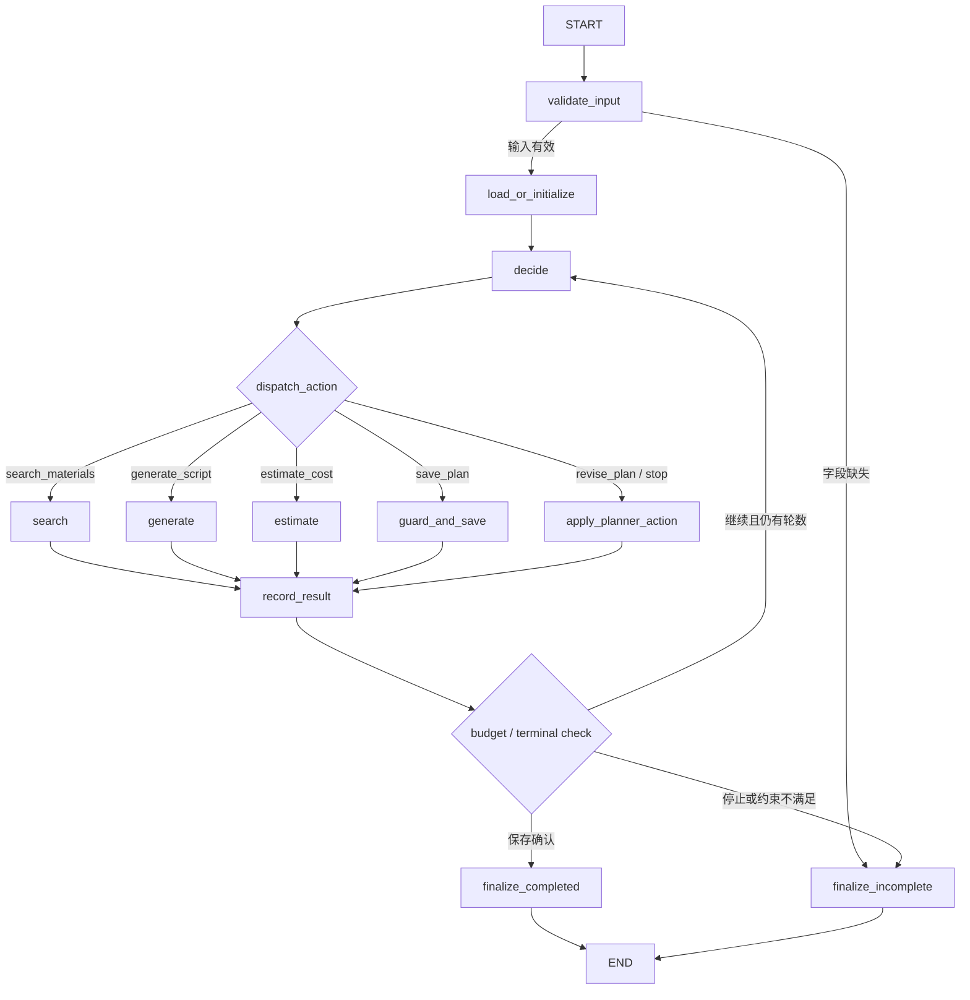

# 内容任务规划 Agent：技术选型分析

> 2026-11-05 更新：已确定使用 LangGraph。本文件保留选型与早期设计演进；后续实施以 `docs/01-requirements.md`、`docs/02-solution.md` 为准。新版明确模拟总预算包含工具费、不可变方案指纹、业务库与 checkpoint 对账及单 worker 限制；36 项审查结论见 `docs/06-design-review.md`，待执行验证见 `docs/03-evaluation.md`。本文件中的工具免费建议和早期流程图不再作为当前规格。

## 1. 结论与适用前提

本分析基于题目与考核规则，属于设计建议，尚未实现或运行项目；下文的执行路径和数字是说明性示例，不是实测结果。框架能力按常见架构模式讨论，实施时应以实际安装版本的官方文档和运行结果为准，并锁定依赖版本。

默认建议：**Python + 原生模型工具调用循环 + Pydantic + SQLite + pytest + CLI**。

如果已经熟悉 LangGraph，或者明确要重点展示跨进程续跑，可选：**Python + LangGraph + Pydantic + SQLite + pytest + CLI**。三小时的建议投入包含代码、测试、真实模型运行记录和文档，不宜全部用于熟悉框架。

如果最熟悉 TypeScript，也可以用 **TypeScript + 模型 SDK + Zod + SQLite + Vitest + CLI**。不要为了语言本身重新学习一套生态；本题没有明显的 Python 独占需求。

核心判断：本题最需要展示的是模型观察结果后改变动作，以及程序对费用、依赖、状态和保存结果的可靠管理。框架名称不会自动补齐这些能力。

## 2. 先明确哪些能力由谁负责

### 模型负责选择

- 依据主题选择检索关键词、素材和内容形式。
- 选择脚本生成方式，以及要提交估算的候选方案。
- 观察超预算、超时、素材不足和工具错误，决定修改、替代、重试或结束。
- 输出简短、面向用户的动作依据，不要求内部思维过程。

### 程序负责执行与校验

- 校验主题、预算、截止时间以及模型输出的动作参数。
- 执行白名单内的工具，并将真实结果作为下一次模型输入。
- 计算费用和耗时、检查步骤依赖、维护状态、保存结果。
- 执行调用次数和时间上限；只有保存得到确认后才能报告完成。

允许程序拒绝超预算的保存请求，并把拒绝结果交给模型重新决策。这种确定性约束与模型动态选择可以同时存在。

反过来，如果程序在超预算后自动把候选方案切成便宜版本，模型只是解释既成结果，就不足以证明模型驱动的重规划。

## 3. 不同技术路线

### 方案 A：Python 原生模型工具调用循环

组成：argparse CLI、Pydantic 数据结构、模型供应商官方 SDK、本地工具函数、sqlite3、pytest。

基本流程：加载任务状态 → 组装约束和工具结果 → 请求模型动作 → 校验动作 → 执行工具 → 保存结果 → 再请求模型，直到结束或达到上限。

**优点**

- 决策循环清晰，评审容易定位“模型选动作”和“工具结果改变下一步”的证据。
- 依赖较少，错误定位和离线测试直接，适合四个工具的小项目。
- 工具、状态和模型接入可以分别测试，费用规则不需要依附框架。
- 有更多时间补齐验收材料，而非解释额外抽象。

**缺点**

- 需要自己实现循环上限、消息关联、状态落盘和异常处理。
- 恢复执行时要明确加载哪些结果、哪些调用已完成。
- 如果把所有逻辑塞进一个循环函数，容易演变成难维护的条件分支。

**适合**：三小时交付、尚未掌握 Agent 框架、希望把关键行为讲清楚。

**控制复杂度的方法**：只拆分模型适配器、执行器、工具、状态仓库和输入输出结构；只做单进程、顺序执行，不自行开发通用工作流平台。

### 方案 B：Python + LangGraph

组成：状态图、模型决策节点、工具执行节点、状态持久化配置、同样的业务校验和测试工具。

建议图结构：输入校验 → 模型决策 ↔ 工具执行 → 最终汇总。边负责动作分发，模型负责业务策略选择。

**优点**

- 状态与流转较显式，适合展示失败后恢复和保留中间结果。
- checkpoint 机制可支持恢复图执行，减少部分控制流程代码。
- 图结构便于解释，后续增加人工确认或额外阶段也较自然。

**缺点**

- 需要理解 state、reducer、checkpoint、运行标识和消息追加等概念。
- checkpoint 不等于业务幂等：工具可能已经产生副作用，而其后的检查点尚未落盘。
- 图很容易被写成“超预算固定跳到便宜方案”，仍然缺少模型决策。
- 学习和调试框架会挤占测试、文档及真实模型验证时间。

**适合**：已有 LangGraph 经验，或者愿意明确投入时间实现和验证跨进程恢复。

建议仍由自己的业务工具检查预算、依赖和保存条件；不要把这些正确性要求寄托在模型提示词或图框架上。

### 方案 C：Google ADK

可通过 Agent、函数工具和会话相关机制组织执行；具体模型适配、会话持久化及恢复能力应按所选版本确认。

**优点**

- 适合已有 Google 模型或工具生态经验的开发者。
- Agent 与工具的组织方式较统一，可利用其事件和会话机制组织记录。
- 如果未来继续使用相关生态，可减少后续接入成本。

**缺点**

- 对本题而言，SDK 和运行机制的学习成本可能大于四个本地工具的实现成本。
- 会话保存不自动保证费用账本正确、结果可复用或保存工具幂等。
- 离线测试仍需要可替换的模型适配器；更换模型供应商前需验证工具调用行为。

**适合**：已经熟悉 ADK、具备可用模型环境，后续方向也与该生态一致。

### 方案 D：AgentScope

可以采用单 Agent 结合工具和状态管理完成本题；不需要引入多个 Agent。

**优点**

- 有 Agent、消息、工具等组织抽象，适合已有相关经验的人快速搭建。
- 后续若确实出现多角色协作需求，可继续沿用生态。
- 可以把模型交互与工具执行整理成较统一的结构。

**缺点**

- 本题主要问题是一个任务中的约束和状态，多角色能力暂时没有明显收益。
- 仍需实现业务依赖、费用核算、重复执行及持久化规则。
- 如果进一步拆成规划、写作、财务多个 Agent，会增加调用、上下文同步与错误定位成本。

**适合**：已经熟悉 AgentScope，能够利用现有经验快速完成单 Agent 方案。

### 方案 E：TypeScript 原生实现

组成：Node.js、TypeScript、模型官方 SDK、Zod、SQLite、Vitest、CLI。

**优点**

- 对熟悉前后端 TypeScript 的开发者，上手更快。
- 运行时参数校验与静态类型结合方便，未来扩展 HTTP API 自然。
- 同样可以清晰实现模型工具调用、持久化和故障注入。

**缺点**

- SQLite 驱动及运行方式需要按目标 Node 版本确认。
- 类型定义与实际运行时数据仍然需要分别验证。
- 对更熟悉 Python 的开发者，没有必要额外承担工具链成本。

**适合**：TypeScript 是最熟悉的语言，或后续已确定要接入现有 Node 服务。

### 不建议作为首版的方向

- 多 Agent：本题没有足够强的角色独立性，容易稀释状态管理重点。
- 自建通用 Runtime、复杂队列或生产工作流平台：超出当前交付规模。
- 只用固定 DAG 或条件分支：可以作为执行骨架，但仍须加入真实模型观察工具结果后的动作选择。

## 4. 推荐组件与具体取舍

### 4.1 模型与接入

选择一个当前可访问、支持结构化工具调用、中文理解够用的模型即可。优先验证：能否稳定选择工具、按 schema 传参、理解错误结果、遵守结束约束。

先用小型探针测试：给出预算 10、报价 12 的工具结果，观察模型是否主动提出修改方案或明确停止。选择依据应来自运行记录；更大的模型或更昂贵的模型不自动意味着更好。

首版只接一个真实供应商，用一个很薄的模型接口隔离 SDK。不要为尚未需要的多个供应商设计完整适配平台。降低采样随机性有助于稳定，但不能保证动作顺序完全一致。

若 SDK 支持原生工具调用，应优先使用。普通文本 JSON 也能实现，但需要更多格式纠正、参数解析和错误处理。结构化调用只解决输出格式的一部分，业务校验仍然必要。

### 4.2 素材检索

使用本地合成 JSON 素材库，包含 id、主题标签、渠道、成本、耗时和可用状态。首版采用标签或关键词检索，并返回有限候选。

优点是可复现、易解释、可注入空结果与部分结果。对于几十条素材，向量数据库和外部搜索增加的依赖通常没有必要。应在文档说明检索边界，不能宣称已经验证真实业务资料的召回质量。

### 4.3 脚本生成

需要区分工具的职责与决策的证据：

- 模板式本地工具：最稳定、方便测试，但内容质量有上限。
- 由工具内部再调用模型：内容更灵活，但增加真实调用费用、耗时和错误面。

三小时首版可让决策模型通过工具参数提交结构化脚本要点，工具结合选定素材生成并验证脚本产物。工具必须真实产生可保存的结果；文档应说明内容来源，避免把模板拼接包装成独立模型创作能力。

若使用第二次模型调用生成正文，也仍可保持单 Agent 架构；模型调用次数增加不等于多 Agent。

### 4.4 状态与持久化

推荐 SQLite：标准库可用、单文件持久化、事务和唯一约束足以支撑重复执行与续跑。数据库属于运行产物；可提交脱敏导出和 Trace，不必提交工作数据库。

JSON 文件更容易开始，但需要额外处理原子写入和并发覆盖。纯内存状态只适合演示，难以证明跨进程重复执行和恢复能力。

不需要为了本题引入 PostgreSQL 或 Redis，除非已有可用环境且能减少工作。

### 4.5 交互入口

首选 CLI：输入文件 → 运行 → 输出结果文件与 Trace。它便于评审复制命令、注入故障、固定时间和重放测试。

HTTP API 适合已有服务基础或明确要对接系统的情况，但还需处理进程启动和请求行为。Notebook 适合探索，容易受到单元执行顺序和隐藏内存状态影响，因此交付时需要明确从干净环境完整执行的步骤。

## 5. 需要提前定义的业务语义

### 5.1 方案预算与执行费用

至少分开保存：

- `quoted_campaign_cost`：当前候选活动方案预计总成本。
- `incurred_tool_cost`：已经实际产生的工具使用费用。
- `remaining_execution_cost`：完成剩余规划步骤预计还会产生的费用。

预算究竟约束哪些项目，应在需求文档中说明。若活动预算包含规划工具费用，保存前应校验已发生费用、尚未发生的规划费用和活动费用之和，并避免同一费用重复计入。

示例中的“12 改成 8”描述的是两个候选方案的报价，不能把两个报价相加成 20。若两次报价工具都各收 1 个单位且计入同一预算，则实际要看 8 + 1 + 1，以及是否还有其他未计费用；不能仅因为报价 8 小于 10 就声称可行。

最简版本可明确规定检索、生成、估算和保存均为免费的合成工具，预算只约束活动方案，并在费用表中显式列出零费用。若要展示付费失败与重试，需要为每个工具定义计费规则并记录已发生费用。

金额采用整数模拟单位或 Decimal。失败是否收费、部分成功如何收费，均由工具结果和规则确定，不由模型自行推算。

### 5.2 截止时间

输入使用明确时区的截止时间。时间校验由程序承担，并区分真实工具调用耗时和合成活动制作耗时。

首版可以明确限制活动步骤按顺序执行，使用顺序工时求和。若要允许并行，则要根据依赖计算完成时间，并说明资源约束；不能仅把所有时长相加或默认所有任务都可并行。

可行性检查需要包括：当前时间、预计剩余制作耗时、已发生的真实时间，以及文档定义的其他缓冲。测试注入固定时钟，避免用例随着日期变化失效。已过期的截止时间应被明确拒绝或标记不可行。

### 5.3 计划、状态和产物

建议任务状态：`needs_input`、`running`、`completed`、`incomplete`。

建议步骤状态：`pending`、`running`、`succeeded`、`failed`、`blocked`、`superseded`。动作尝试另行记录；重试成功不能抹去之前失败的事实。

`incomplete` 配合原因码，例如预算不足、时间不足、工具故障、调用上限或模型不可用。状态可以精简，但含义不能模糊。

每个步骤记录工具、参数、依赖、尝试记录和产物引用；每个产物记录输入指纹或版本、有效性和产生来源。

更换方案后，原素材仍适用则可复用；旧报价可能因为方案变化而失效。已成功步骤的历史与结果仍需保留，但不代表这些结果还能用于当前方案。

### 5.4 重复执行与续跑

这两个验收点需要分别设计：

- 重复执行：相同任务标识和相同输入，已完成则返回既有方案，不重复保存或计费。
- 失败续跑：加载失败任务的状态，保留仍有效的成功产物，允许模型决定如何处理剩余工作。

建议调用方显式提供 `request_id`，同时保存规范化输入的指纹。相同标识但输入不同应报冲突；有意重新生成则使用新标识。仅凭输入 hash 去重，可能把用户主动发起的新任务误判为重复。

首版把已保存方案存入同一个 SQLite 数据库，利用事务与唯一约束处理重复保存，会比同时维护数据库和外部文件的原子一致性简单。可以再导出可读文件作为展示产物，并在导出失败时记录实际状态。

进程可能在工具完成后、状态落盘前中断。数据库事务只覆盖自身；如果未来接入外部付费工具，还需要供应商幂等键或结果对账机制。不能宣称任意外部调用都能实现恰好一次执行。

### 5.5 调用上限与无进展

至少设置模型决策轮数、工具调用次数和总墙钟时间上限。自动重试、参数纠正等也要计入对应限制。

可以附加重复动作检测，避免模型无变化地重复失败调用。正常的有界传输重试可以保留，但这部分不算模型重规划证据。

当模型没有返回工具调用时，执行器仍要检查完成条件；自然语言声称“已保存”不能代替真实保存结果。达到上限后输出 `incomplete`、已完成步骤、剩余工作和费用，不得伪造成功。

## 6. 四个工具的建议契约

### `search_materials`

输入：主题关键词、渠道、内容形式、可选限制。

结果：候选素材、来源 id、检索覆盖情况、缺失条件、工具费用。支持无结果及部分结果，供模型选择扩大检索或降级方案。

### `generate_script`

输入：候选方案版本、素材 id、内容形式、脚本要点。

结果：脚本产物 id、成功生成部分、失败部分、警告与费用。没有产物的步骤不能标为成功；部分成功应保留已生成部分及其可用范围。

### `estimate_cost`

输入：具体方案版本、素材和脚本引用。

结果：分项费用、总成本、制作耗时、预算缺口、时间缺口、规则版本。采用确定性规则计算；估算可以正常成功，同时返回方案不可行。

报价 12 超预算并不等于估算工具执行失败，应区分 `tool_status=success` 与 `feasible=false`。

### `save_plan`

输入：任务标识、有效方案版本及产物引用、有效报价引用。

结果：保存记录 id 或失败原因。工具自身核验依赖、费用、时间、报价是否匹配当前方案，再执行幂等保存。不能仅相信模型提交的总金额或步骤状态。

所有工具使用一致的结果外层，包含成功/失败/部分成功、错误码、可否重试、实际费用和产物引用。错误应成为模型可观察的数据，而非只写入终端异常日志。

## 7. 如何证明动态决策

以下是待实施验证的路径设计，不能直接作为实际运行记录提交。

### 路径 A：报价超限后改选方案

检索素材 → 生成视频方案 → 估算返回 12，预算为 10 → 模型选择复用素材、改为图文方案 → 重新生成受影响产物 → 估算返回 8 → 保存。

关键证据：更换内容形式的动作来自读取报价结果后的模型输出；报价与产物版本对应；原有素材结果得到保留。

### 路径 B：一次工具失败后的替代

检索成功 → 某种脚本生成方式返回可识别故障 → 模型选择可用的替代方式 → 继续估算和保存。

关键证据：失败尝试保留为失败；成功检索未丢失；新调用的方式或参数体现调整。若只是执行器自动原样重试，不能用它作为重规划的主要证据。

### 路径 C：无可行候选时结束

最低可用候选报价为 11，预算为 10，且候选集合和规则能够支持这个结论 → 模型结束任务 → 输出未完成、已知缺口 1 和已获得产物。

若搜索范围并不穷尽，只能报告“当前已检索候选中未找到可行方案”，不能声称全局无解。预算缺口与时间缺口可以来自不同方案，不能拼接成一个实际不存在的可行解。

## 8. 测试与记录策略

### 确定性测试

使用脚本化模型替身、可注入时钟和工具故障。替身用于验证执行器对动作和结果的处理，不能证明真实模型会自主调整。

至少覆盖：

1. 正常完成，保存结果存在且总费用正确。
2. 缺预算、缺截止时间，以及两者都缺失；返回需补充字段，不执行有副作用的工具。
3. 工具失败后采用替代方式，保留失败记录和已成功产物。
4. 超预算后改选较便宜方案，重算后保存。
5. 所有已知候选都超限，返回未完成与有依据的缺口。
6. 截止时间不足或已经过期，拒绝保存并说明原因。
7. 相同任务标识重复执行，不重复生成保存记录或计费；不同输入产生冲突。
8. 达到轮数、工具调用或时间上限，返回明确未完成。
9. 修改方案使旧报价失效，不能用旧报价保存新方案。
10. 保存失败，不能将任务记为完成。

若实现续跑，再加入“第一次失败并退出，第二个进程恢复后成功”的集成测试，而不只是同一进程内再次调用函数。

### 真实模型验证

至少保留两条由不同工具结果引发不同动作的实际路径。推荐一条预算调整，一条工具故障替代；另提交正常完成和资料不足等场景，覆盖全部验收点。

采用真实决策模型和合成本地业务工具符合要求。模型不可用时提供离线 Mock 入口，但应明确标注缺少真实模型决策验证，不得把替身 Trace 冒充真实模型记录。

真实模型可能合理地选择不同动作顺序。测试应优先检查业务不变量，例如预算、依赖、实际保存和上限；只有专门测试固定工具协议时才严格断言调用顺序。

### Trace 内容

记录任务标识、模型和依赖版本、模式、步骤序号、动作、工具参数、结果摘要、费用、计划版本、状态变化和简短动作依据。测试结果与实际输入输出放在 examples，评估文档逐一引用。

不要提交内部思维过程、真实密钥或隐私。Trace 应源于实际执行事件，不能在运行结束后编造完整决策轨迹。

## 9. 建议的三小时分配

以下是范围控制建议，不是对实际完成速度的保证；应记录真实投入。

- 0–20 分钟：明确费用与时间语义，建立合成数据、输入结构和模型工具调用探针。
- 20–65 分钟：完成四个工具、约束校验和模型决策循环。
- 65–105 分钟：加入 SQLite 状态、重复执行、故障注入和循环上限。
- 105–145 分钟：运行核心测试，完成真实模型的不同决策路径并保存 Trace。
- 145–180 分钟：补齐 README、五份文档、运行命令和提交材料。

如果时间紧张，优先保证必须验收点、真实模型证据与交付材料完整；跨进程失败续跑可明确列为未完成项。不要用界面或更多框架掩盖核心路径未验证。

## 10. 最终建议

**没有明确框架经验：采用 Python 原生实现。** 它最方便围绕四个工具建立一个小而可解释的决策循环，并将时间投入业务正确性和验证。

**已有 LangGraph 经验：采用 LangGraph。** 重点利用显式状态和恢复机制，同时自行实现业务幂等、产物有效性和预算校验。

**已有 ADK、AgentScope 或 TypeScript 经验：继续使用熟悉的工具。** 不必为这道题换生态，前提是能够展示同样的决策、状态和测试证据。

最有价值的展示不是 Agent 调用了多少工具，而是：它为什么根据结果改计划，哪些成功结果被复用，费用和截止时间如何被校验，以及失败后为何仍能准确报告实际状态。

## 11. LangGraph 详细设计

本节是待实现设计，不代表已经验证 LangGraph API 或产生真实模型运行结果。实现时应锁定 LangGraph 与 saver 依赖版本，按该版本文档核对导入路径、checkpoint 配置及状态 reducer。

### 11.1 架构原则

采用单 Agent、顺序执行、有界状态图。模型选择任务动作；图根据模型给出的结构化动作选择执行节点；工具执行器对费用、依赖、时间和保存条件做权威校验。业务失败结果返回给模型，由模型选择调整方案、尝试替代或停止。

固定流程只负责保证每个候选方案在执行前经过必要的估算和校验，不负责替模型自动换方案。运行记录必须能看到模型读取工具结果后产生的新动作。

流程中至少有两种循环预算：模型决策轮数 `max_decisions`、工具尝试次数 `max_tool_attempts`；另外设总运行时间 `deadline_at`。任何自动重试也计入工具尝试次数。耗尽时由图产生 `incomplete` 终态及原因，不允许模型覆盖终态。

### 11.2 状态机

建议的图形流程：



`dispatch_action` 是路由边，不做业务决策。`decide` 每轮把当前任务、有效计划版本、缺失资料、步骤结果和费用汇总交给真实模型，并要求它返回动作结构与简短依据。图的确定性约束可以拒绝非法动作，但不能暗中替模型选替代方案。

如果采用 LangGraph `ToolNode`，应检查本项目所需的参数校验、调用计数、保存守卫和错误结构是否容易实现；若不易表达，使用显式工具执行节点更直观。工具节点调用本身不是动态决策证据。

### 11.3 状态数据结构

建议以 Pydantic schema 定义节点输入输出，LangGraph state 保存可序列化数据。具体 State 可实现为 TypedDict 加 Annotated reducer，或使用项目锁定版本支持的类型形式。避免将 SDK 对象、数据库连接、异常对象或任意 Python 类直接写入 checkpoint。

```text
TaskState
  schema_version: int
  task_id: str
  request_id: str
  input_fingerprint: str
  input: {topic, budget, deadline_at, timezone, constraints}
  status: needs_input | running | completed | incomplete
  current_plan: {plan_id, version, format, material_ids, script_id, estimate_id}
  plan_history: [PlanSnapshot]
  steps: {step_id: StepRecord}
  artifacts: {artifact_id: ArtifactRecord}
  tool_attempts: [ToolAttempt]
  cost_ledger: {campaign_quote, incurred_tools, currency, rules_version}
  decision_log: [DecisionRecord]
  limits: {max_decisions, max_tool_attempts, deadline_at}
  counters: {decisions, tool_attempts}
  pending_action: PlannerAction | null
  final_result: FinalResult | null
```

`ToolAttempt` 追加记录每次实际尝试，包含工具名、规范化参数摘要、幂等键、开始/结束时间、结果分类、错误码、实际费用与产物引用。失败重试成功后，步骤的最终状态可为 `succeeded`，但早先 attempt 仍保留为失败。

`StepRecord` 状态使用 `pending`、`running`、`succeeded`、`failed`、`blocked`、`superseded`。步骤整体最终状态和单次调用状态分离，避免重试抹掉失败历史。

`DecisionRecord` 只保存动作、观察摘要、简短依据和轮次，不保存模型内部思维过程。所有列表型状态更新要明确定义 reducer，避免节点返回的部分更新无意覆盖已有成功记录。

### 11.4 动作协议与动态路由

用受约束的 Pydantic 联合类型描述模型动作，字段至少包括：

- `action`: `search_materials`、`generate_script`、`estimate_cost`、`save_plan`、`revise_plan`、`stop`。
- `reason_summary`: 一句话说明动作依据。
- `arguments`: 与动作对应的结构化参数。

例如报价结果返回 `quote_total=12`、`budget=10` 后，模型动作应是 `revise_plan`，其 arguments 明确指定图文格式或更低成本的素材/渠道，理由摘要指出当前版本超过预算。图记录模型原始动作和路由结果，然后调用对应工具。

动作通过 schema 后仍须检查：当前状态是否允许该动作、依赖是否已有有效产物、调用额度是否足够、输入版本是否匹配。检查失败作为 `invalid_action` 观察写回状态，可允许有限的一次模型纠正；纠正也计入决策轮数。绝不可静默替换动作。

### 11.5 步骤依赖与方案版本

推荐依赖关系：

```text
用户输入
  -> 搜索素材
  -> 生成脚本
  -> 估算当前 plan_version
  -> 保存同一 plan_version
```

可以为多个候选方案复用搜索素材，但脚本和报价应明确关联方案版本。修改影响格式、渠道、素材或工作量时，创建新 `plan_version`；不受影响的素材检索结果可继续引用，脚本是否可复用按依赖字段判定。与旧版本绑定的估算一律不得用于新版本保存。

保存守卫必须重新检查：报价关联当前计划版本；报价工具执行成功且可行；报价在预算内；预计完成时间不晚于截止时间；所有必须产物存在且有效；没有缺失依赖。守卫失败返回结构化业务结果给模型，任务保持未完成。

### 11.6 成本与时间校验

`estimate_cost` 是确定性业务工具，返回报价分项、候选方案总费用、制作耗时、预算/时间缺口、规则版本和被评估的 `plan_id/version`。它执行成功与方案可行是不同字段：`tool_status=success` 且 `feasible=false` 是合法结果。

预算约束对象须写入需求和 Trace：首版建议明确为活动方案预算，合成工具检索、脚本生成、估价、保存均免费，并在费用表中标为 0。这样估算 12 与 8 的候选比较不会混入未定义的 Agent 运行费用。若工具后续收费，再把已发生费用独立加入 ledger，并定义失败是否收费。

时间以固定时钟和显式时区校验。顺序步骤采用剩余步骤时长求和；真实执行时间用于判断 deadline 是否已被超过。首版不承诺并行排程。测试注入 `now`，让截止时间场景可重复。

### 11.7 检查点、恢复与幂等

选用 SQLite checkpointer 持久化图 checkpoint，并使用稳定的 `thread_id=task_id`。若使用跨进程继续任务，需实际验证所选 SQLite saver 的连接生命周期、并发限制、checkpoint 创建和恢复行为。MemorySaver 只用于单进程测试或演示，不作为持久恢复证据。

需区分：

1. **进程中断恢复**：用同一个 `thread_id` 从最新 checkpoint 继续；恢复前审计当前节点和外部工具结果。
2. **已终止任务续跑**：任务已返回 `incomplete` 后，由恢复入口加载业务状态，增加 `run_id` 或决策轮次并重新启动决策；保留仍有效产物。
3. **重复提交**：用 `request_id` 和输入 fingerprint 查询既有任务。相同标识、相同输入且已完成，返回既有结果；相同标识、不同输入返回冲突；有意新建任务使用新的 request_id。

LangGraph checkpoint 不能单独保证工具恰好执行一次。每个工具调用使用业务幂等键，例如 `task_id + plan_version + step_id + canonical_args_hash`。工具执行前在 SQLite `tool_attempts` 表登记 `started`，成功后在事务中保存结果和 `succeeded` 状态。恢复时遇到 `started` 状态，应通过工具结果查询/对账，或由本地确定性工具按幂等键重放；不得盲目再次产生副作用。

本题本地合成工具可通过数据库唯一约束安全去重。若换成真实外部服务，必须使用对方幂等键或结果查询能力；不支持时要明确存在“外部调用成功但本地未落盘”的不确定窗口，不能声称 exactly-once。

注意：LangGraph 中断/恢复会受到中断节点代码再次执行影响。需要把有副作用的工具放在明确节点中，并确保恢复不会误重复执行；对计划中的具体版本做一次故障注入集成测试。

### 11.8 工具错误分类与 tenacity 策略

统一工具结果分类：

- `success`：调用成功；业务可行性另有字段。
- `partial_success`：部分产物可用，明确列出成功产物与缺失项。
- `transient_error`：超时、限流、临时网络错误，且已知可安全重试。
- `permanent_error`：输入非法、素材源不可用等不可通过同参数重试解决的问题。
- `business_rejection`：超预算、超截止时间、缺少依赖或保存守卫拒绝。

对 `transient_error` 可用 tenacity 做有界指数退避；只有在操作幂等或供应商支持幂等键时才允许自动重试。每次 retry 写一条 ToolAttempt，计入调用总预算；达到次数上限后把错误交给模型，由模型决定换方案、换方式或停止。

原方案“重试成功不标记为失败”应理解为：步骤最终状态为 `succeeded`，同时 Trace 中保留先前的失败尝试。十次自动重试成功仍只能证明技术容错，不能替代模型根据结果重规划的证据。

仅对明确的瞬时技术异常进行原参数重试。素材无结果、预算超限和截止时间不可行属于业务结果，不应用 tenacity 重试。

### 11.9 四个业务节点

| 节点 | 执行职责 | 成功/失败后的状态更新 |
|---|---|---|
| `search_node` | 按模型给定条件查询合成素材库 | 保留素材 ID、检索覆盖和零结果/部分结果 |
| `generate_node` | 用当前计划版本与有效素材生成脚本产物 | 写入产物引用；部分失败只成功记录真实生成部分 |
| `estimate_node` | 按规则计算当前版本费用与制作耗时 | 写入带版本的报价；超预算仍算估算工具成功但不可行 |
| `save_node` | 事务内做最终守卫并幂等保存方案 | 仅数据库提交成功后设置保存 ID 与完成状态 |

单独的 `record_result` 节点把工具事件追加到 Trace/状态，随后回到 `decide`。若当前 LangGraph 版本的 checkpoint 已能充分保留节点输出，也仍要将业务记录持久化到数据库，便于评审导出 Trace 和跨 run 对账。

### 11.10 最终输出契约

CLI 最终输出 JSON 至少包含：

```json
{
  "task_id": "...",
  "status": "completed | incomplete | needs_input",
  "plan": {"version": 2, "format": "..."},
  "steps": [],
  "tool_results": [],
  "quoted_campaign_cost": 8,
  "incurred_tool_cost": 0,
  "saved_plan_id": "...",
  "incomplete_reason": null
}
```

`status=completed` 的必要条件是 `saved_plan_id` 有数据库确认记录。其他情况必须返回未完成原因、已成功步骤、可复用产物和费用；不能只输出异常堆栈或把失败步骤标为成功。

### 11.11 验收与集成测试矩阵

| 用例 | 注入结果 | 预期模型动作/系统不变量 |
|---|---|---|
| 正常完成 | 搜索、生成、估算、保存全成功 | 保存当前版本；费用和依赖正确 |
| 缺预算或截止时间 | 输入缺字段 | 返回 `needs_input`；不调用生成、估算、保存 |
| 预算超限 | 方案 A 报价 12，预算 10；方案 B 报价 8 | Trace 显示模型观察 12 后选择 B；重估当前版本后才保存 |
| 无可行方案 | 已知候选最低报价大于预算 | 模型停止并说明已知缺口；保存记录不存在 |
| 工具失败替代 | 首次生成返回永久错误，替代工具/形式可用 | 保留失败尝试与成功素材；模型选择不同动作；最终状态准确 |
| 瞬时故障重试 | 第一次超时，幂等重试成功 | 两个 attempt 均记录；步骤终态成功；费用按规则记录 |
| 部分成功 | 脚本生成部分章节 | 只保留真实产物；模型决定补全或降级，不冒充全成功 |
| 重复执行 | 相同 request_id 与输入提交两次 | 方案保存行和计费不增加，返回既有结果 |
| 输入冲突 | request_id 相同但输入不同 | 明确冲突，不复用旧方案 |
| checkpoint 恢复 | 工具已产生结果后模拟进程中断 | 恢复时先查幂等键/结果，不能重复产生副作用 |
| 续跑 | 前一次工具失败退出；新 run 加载持久化状态 | 保留有效成功产物，模型只需处理未完成工作 |
| 预算/工具上限 | 达到调用或决策轮数 | 明确 `incomplete`，保留已有状态，不再调用工具 |
| 截止时间不足 | 固定时钟下预计完成晚于截止时间 | 保存守卫拒绝，任务不能标成完成 |
| 保存失败 | SQLite 插入失败或唯一键冲突 | 保留成功步骤，任务仍未完成，不伪造保存 ID |
| 陈旧报价 | 改方案后仍尝试旧 estimate_id | 保存守卫拒绝，要求重估 |

离线测试使用脚本化模型按输入事件依次返回工具调用，只验证图的路由、状态 reducer、费用守卫和恢复行为；不能证明模型能够自主改方案。另需保留真实模型执行的预算重规划和工具失败替代 Trace。

### 11.12 建议实施目录

```text
src/
  agent/
    graph.py             # StateGraph、节点注册、条件路由
    state.py             # TypedDict/Pydantic State 与 reducer
    actions.py           # 模型动作 schema
    prompts.py           # 决策约束和格式
    model.py             # 单供应商适配器与离线替身入口
  tools/
    materials.py
    script.py
    estimate.py
    save.py
  persistence/
    database.py          # SQLite 任务、尝试、方案与产物
    checkpointer.py      # LangGraph SQLite saver 配置
  cli.py
tests/
  test_estimate_rules.py
  test_graph_routing.py
  test_save_guards.py
  test_idempotency.py
  test_resume.py
examples/
  inputs/
  outputs/
  traces/
```

项目文件名与模块应遵循实际选定 saver 的包名与版本，不在实现前假定所有 saver 都由同一个 LangGraph 包提供。开发前用极小探针确认：构建最小图、写入 checkpoint、关闭进程、同 thread_id 恢复，并确认工具节点不会被意外重复调用。

## 12. 实施顺序与三小时范围

按风险优先实现：

1. 固定业务语义、schema、合成数据和成本/时间规则。
2. 实现四个确定性工具、保存守卫和 SQLite 业务账本。
3. 构建 LangGraph 最小决策循环，接真实模型工具调用，并限制决策与工具次数。
4. 写预算重规划、工具失败、缺输入、重复提交测试。
5. 验证 SQLite checkpoint 的进程恢复及工具幂等；若超出时间，明确把跨进程续跑列为未完成，而不是仅凭 saver 存在声称通过。
6. 运行真实模型路径，保存真实输入输出与 Trace，再补齐 README 和五份文档。

关键风险是把“可 checkpoint”误认为“业务可安全重放”。完成标准应是测试证明在实际故障窗口下不丢失有效结果、不重复副作用，且失败状态可解释。
